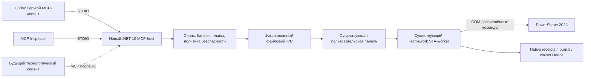

# План разработки PowerShape MCP на основе Bridge

12 октября 2026. **План принят пользователем: разработка до К11.** К0 закрыт;
К1 выполняется. Для Autodesk Product Help пользователь разрешил `en_US`.
Установка программ завершена; уведомление
«Софт установлен, я готов к планированию» отправлено до анализа модулей.

Исходная Git-база: `625d792b3581683549af24f50efce44dd11bcc0a`, публичный
[danro-work/PowerShapeBridge](https://github.com/danro-work/PowerShapeBridge).
План подготовлен в ветке `docs/dotnet-mcp-plan`. Состояние CAD-возможностей
берётся из [PROJECT-STATE.md](PROJECT-STATE.md) и контрактов; живой CAD в этом
блоке заново не проверялся. Матрица переноса — [MODULE-MIGRATION-MATRIX.md](MODULE-MIGRATION-MATRIX.md).

## Что уже есть

| Блок | Подтверждённая база PowerShape Bridge | Ограничение |
|---|---|---|
| Связь с PowerShape 2023 | C# x64/Framework STA-worker, пользовательская панель, фиксированная файловая очередь | Один поддержанный CAD-маршрут; несколько экземпляров/неоднозначность требуют явной политики |
| Публичный MCP | Python STDIO 0.31.0; в текущем general-профиле 21 tool, read-only 6 | Современного C# SDK-host ещё нет; подключение старого чата 0.22.0 в отчётах отделено от свежего адаптера |
| Документы и чтение | Перечень/проверяемый выбор открытого документа, inventory/наблюдаемые свойства, временные read references | IDs не постоянны; не все свойства/единицы доступны; наблюдения не доказывают полную топологию |
| Подготовка безопасного действия | Observed entity sets, immutable local plan, binding и disabled owned packet | Подготовка/standalone validation не разрешают edit; live sets нескольких типов/моделей не приняты целиком |
| Рабочие файлы | Saved-byte рабочая копия, независимый ReadOnly checkpoint, ownership/native file identity и own OPEN/verify | Unsaved CAD-state не копируется; общего SaveAs результата и отдельного reopen ещё нет |
| Первое изменение | Один owned SOLID, TranslateItem один раз, два held-context guard, отдельный verify | Живая квалификация P2.31: только X +1 и отдельное X −1 на одной своей копии |
| Неизвестный исход | Постоянный claim, mutation fence, native journal, запрет replay, independent receipts | Прерывание без return и codes 0/−1 требуют нового recovery-контракта; общий recovery не готов |
| Квалификационные прототипы | Transform/поверхности/25 секущих/одно пересечение/DGK на эталонах, аудит и сохранённые отчёты | Это рецепты/доказательства, не принятые универсальные tools |
| Разработка и инструменты | Git/GitHub, установленный skill, .NET 10 SDK/Node/Inspector/C# extension | NuGet зависимости проверены как кандидаты, а SDK-host/новый CI ещё не созданы |

Последняя сохранённая приёмка P2.31: 114 Python-тестов, 312 C#-проверок,
MCP-протокол и аудит 55 MCP-вызовов. При установке/планировании они заново не
запускались. Состояние текущих процессов/документов перед будущим CAD-тестом
проверяется заново, а не берётся из этих отчётов.

## Что нужно переписать и разработать

| Решение | Перечень |
|---|---|
| **Сохранить и вызывать через worker** | Native COM-reader, DocumentSession, EntitySets, OwnedCopies, DocumentBindings, NativeJournal, own-open/translation executors/verifiers и существующий launcher |
| **Переписать по SDK** | Ручной JSON-RPC/STDIO dispatcher `mcp_server.py`, registration/catalog, negotiation/cancellation handling, общий error/result mapping; выделить IPC client из монолита |
| **Перенести Python-правила в C# с паритетом** | Read/document handles, entity sets, local plans, copy leases, bindings, owned packets и execute/verify facades. SDK эти правила не реализует |
| **Разработать новые функции** | Owned SaveAs/result/reopen, общий recovery, недостающие общие transforms/organization/sections/exchange/observation, многомодельная приёмка и новый build/CI/release |
| **Отложить/использовать как квалификацию** | Фиксированные surface/slice/group/DGK recipes и технологические jobs; затем отдельный технологический клиент |

Точные файлы, зависимости и обязательные проверки каждой строки перечислены в
[MODULE-MIGRATION-MATRIX.md](MODULE-MIGRATION-MATRIX.md).

## 1. Предлагаемый результат

Общий локальный MCP для PowerShape 2023 с публичным C#/.NET 10 STDIO-хостом,
официальным ModelContextProtocol SDK и существующим исполнителем CAD в
пользовательском Windows-сеансе. Сначала принять перенос протокола и правил
безопасности, затем завершить функциональность общего v1. Технологический
модуль остаётся следующим отдельным продуктом и клиентом MCP.

Перенос на SDK сам по себе не завершает MCP v1. P2.31 уже имеет чтение,
владение сохранёнными копиями, open/binding/guard и первый executor. Живая
квалификация геометрического перемещения P2.31 ограничена одним SOLID и X ±1
на одной собственной копии; SDK-миграция ещё не начата.
SaveAs/reopen результата, interrupted recovery, несколько моделей и многие
общие операции ещё требуют разработки и независимой квалификации.

Не переносим в ядро материал, W/h/k, Z-stop, ОТМ/ТМ, NO_SCALE и правило
технологического DGK. Не обещаем полное покрытие всех 643 исследованных API
members. Обязательные операции v1 фиксируем по [MCP-V1-CONTRACT.md](MCP-V1-CONTRACT.md);
исключения из согласованного объёма требуют отдельного решения пользователя.

## 2. Принятая архитектура

Современный хост не создаёт собственный COM-канал и не запускает вторую
панель/worker. Квалифицированные алгоритмы worker сохраняются в первом блоке.
Файловая очередь имеет одного действующего CAD-исполнителя. Старый и новый
адаптеры сравниваются параллельно на fake-panel; живая работа выполняется по
назначенному сценарию с единственным активным маршрутом изменения.

Предлагаемые логические модули нового хоста; физические каталоги пока не созданы:

| Модуль | Ответственность |
|---|---|
| `PowerShapeMcp.Host` | STDIO, SDK-регистрация, DI, сведения о сервере, stderr-логи |
| `PowerShapeMcp.Tools` | Публичные методы и описания; отдельные разрешённые каталоги read-only/full |
| `PowerShapeMcp.Contracts` | Типизированные входы/результаты, точные схемы, native envelope v1 и ошибки |
| `PowerShapeMcp.Session` | Область подключения, ссылки/leases, атомарное потребление и отзыв |
| `PowerShapeMcp.Safety` | Наборы, локальные планы, зависимости ownership/binding, запрет replay |
| `PowerShapeMcp.BridgeIpc` | Request/response correlation, atomic submit, maintenance, deadline и исход после отмены |
| `PowerShapeMcp.Proof` | Чтение исходных bytes/хешей, проверка receipts; независимые Python-аудиторы сохраняются |
| `PowerShapeMcp.Tests` | Fake-panel, SDK client/protocol, golden wire/hash fixtures и negative cases |
| Существующий Framework worker | COM, held-context guard, однократная команда, native journal и независимая verification |

Это логические границы, не требование создать восемь библиотек сразу. Минимальный
пилот может иметь один host и один test project с указанными каталогами. Общая
сборка native worker остаётся прежней до отдельно принятого изменения.

## 3. Контрольные точки

Каждый этап заканчивается небольшим PR и отчётом: что проверено, чем подтверждено,
какие ограничения остались. Названия будущих артефактов ниже — требования к
следующим этапам, а не существующие результаты. Статусы: **запланировано →
реализовано → проверено без CAD → квалифицировано в CAD → принято**. Для этапов
без CAD соответствующая ступень отмечается «не требуется», а не подменяется тестом.

| Точка | Результат | Что вы сможете проверить | Условие перехода |
|---|---|---|---|
| **К0 — согласование плана** | Этот план, матрица модулей, границы v1 | Архитектура, перечень операций и роль существующего worker | Пользователь принимает план либо вносит изменения. До этого код нового MCP не разрабатывается |
| **К1 — воспроизводимая база** | Source/build baseline, synthetic fixtures, отдельный Windows CI | PR, сборка чистого checkout, отчёт старых обязательных проверок без PowerShape | Явный профиль из `config`; подготовлены native synthetic journals; нет зависимости CI от моделей/runtime из `work` |
| **К2 — минимальный SDK-host** | `.csproj`, закреплённые SDK/packages, fake-panel, первые `bridge_status`/`operation_result` | `dotnet build/test`, Inspector transcript, JSON-RPC stdout и отдельные stderr-логи | Negotiation, схемы, точные аргументы, ошибка/тайм-аут/отмена проверены без CAD; поддержка существующих клиентов доказана |
| **К3 — полный режим чтения** | Шесть инструментов чтения P2.31, новые session-bound references | Каталог Inspector, сравнительный отчёт Python/C#, отказы по stale/cross-document/expired references | Нет активации, изменения выделения/геометрии, создания копии, save или screenshot; чтение выделения и геометрических измерений допустимо; запреты действуют при прямом tools/call |
| **К4 — перенос состояния и подготовки** | Typed stores: sets/plans/copies/bindings/disabled owned packet | Golden JSON/hash fixtures, таблица схем/ошибок, tamper/expiry/concurrency tests | Сохранены byte SHA и обе digest encoding; TTL не продлевается; prepared plan/packet не исполняет CAD |
| **К5 — паритет существующего исполнения** | Owned open/verify и один SOLID translation/verify через новый host | Сценарий на новой собственной копии, native events, commandCalls=1, independent verifier и fence | Новый клиент отдельно квалифицирован; старый OPEN P2.29 не повторяется; live переключение нового адаптера принимается пользователем по готовому пакету |
| **К6 — owned SaveAs и reopen** | Новый собственный result target, защищённое сохранение, отдельное повторное открытие | Контракт target ownership, hashes источника/checkpoint/result, состав/координаты/единицы после reopen | Один SaveAs; unknown не повторяется; source/checkpoint не перезаписаны; новая document binding проверена независимо |
| **К7 — recovery** | Отдельный recovery-reader/state machine и матрица прерываний | Lost response, timeout, non-success code, partial journal и changed context; журнал разрешения исхода | Unknown сохраняет fence/claim; нет retry/inverse/Undo/cleanup по догадке; восстановление из checkpoint принято отдельным сценарием |
| **К8 — общие transforms и организация** | Параметризованные move/rotate/uniform scale, selection/levels/workplanes | По одному feature-PR и матрице типов; изменён ровно заданный набор и заданная система координат | Приёмка по согласованным типам и центрам; сохранённый результат проверен; ограничения вынесены в каталог |
| **К9 — секущие, пересечения, обмен и наблюдение** | Общие plane set/array, intersection sets, import/export, owned close и согласованные средства наблюдения | Явные наборы/offset, manifest temporaries, форматы и файл результата; CAD-данные, image и доступность UI показаны отдельно | Отверстия/пустые/открытые контуры и локальные координаты проверены; удаляются/закрываются только свои объекты/документы; screenshot никогда не входит в read-only |
| **К10 — квалификация v1** | Матрица пяти классов моделей/сеансов и всех обязательных операций | Для каждой строки: результат, proof artifacts, verifier, ограничения; нет «готово» по одному эталону | Нет неразрешённых unknown в успешных сценариях и скрытых skip; ожидаемые unknown в fault tests подтверждены с fence/claim/no replay; измерения не выдаются за полную топологию |
| **К11 — выпуск и приёмка** | Version manifest, release candidate, инструкция установки/диагностики и rollback | Чистая установка, restart/reconnect, версии, один исполнитель, рабочий read-only, release/tag и перечень поддержанного | Пользователь принимает v1 после технических доказательств. Только затем начинается отдельный технологический клиент |

К8 и К9 разбиваются на отдельные операции: например, move → rotate → scale;
levels → selection → workplanes; plane set → array → intersection → formats → close.
Не принимать большую группу по единственному удачному вызову. Recovery К7 проверяется
для каждой новой мутационной операции, а не только один раз для translation.

К1–К5 — перенос существующей базы на SDK. К6–К11 — завершение общего рабочего v1.
Успешные прежние P2.31-тесты не являются автоматической приёмкой нового хоста.

Покрытие групп исходного контракта; строки не исчезают при создании GitHub issues:

| Группа MCP-V1-CONTRACT | Точка | Обязательный артефакт/сценарий |
|---|---|---|
| Сеанс | К3/К5/К10 | Обнаружение/выбор поддержанного экземпляра, process/session/version/busy report; отказ при неоднозначности; ограничение одного процесса явно принято |
| Чтение | К3/К10 | Inventory/properties/units/selection/workplanes report с unavailable/warnings и системой координат |
| Ссылки | К3–К5/К10 | TTL, cross-client/document, switch/reopen/tamper и consume/revoke fixtures |
| Преобразования | К5/К8/К10 | Параметры, точный target set, до/после, saved-result/reopen report |
| Организация | К8/К10 | Selection/levels/workplanes и отсутствие воздействия на посторонние объекты |
| Плоскости | К9/К10 | Явные позиции, размеры и покрытие, число собственных объектов |
| Пересечения | К9/К10 | Два явных набора, offset, все созданные кривые и owned-temporary manifest |
| Файлы | К6/К9/К10 | Новый owned target, объявленные форматы, source/checkpoint protection и независимый reopen |
| Наблюдение | К3/К9/К10 | Отдельные проверки CAD-данных, изображения и признаков UI/занятости; screenshot только вне read-only; недоступность показана явно |
| Восстановление | К7 и каждый новый executor/К10 | Fault matrix, journal evidence, expected unknown/fence/no-replay и отдельно checkpoint recovery |

Переход из К3 к полной live работе не производится автоматически: пассивный
pilot проверяет свежий процесс/сеанс/документ; переключение обычного клиента
принимается в К5. Невозможность надёжно разрешить конкретный fault может быть
правильным безопасным результатом `outcome_unknown` с сохранённой блокировкой;
она документируется, а не превращается в успех или догадку об отсутствии изменений.

## 4. Как переносить нынешний каталог

| Очередь переноса | Публичные инструменты существующего general-v1 | Условие |
|---|---|---|
| Диагностика | `bridge_status`, `operation_result` | К2; пока fake-panel |
| Чтение | `list_documents`, `inspect_active_model`, `resolve_entity_references`, `inspect_entity_candidates` | К3; вместе с диагностикой это шесть read-only tools текущего экспериментального профиля |
| Подготовка состояния | `activate_document`, `prepare_entity_set`, `validate_entity_set`, `prepare_operation_plan`, `inspect_operation_plan` | К4; activation отдельно квалифицируется как изменение контекста; в read-only этих методов нет |
| Копии и связь | `prepare_working_copy`, `inspect_working_copy`, `bind_working_document`, `validate_working_document_binding`, `prepare_owned_operation`, `validate_owned_operation` | К4; native filesystem/COM checks сохраняются, disabled packet не даёт права изменить модель |
| Однократные действия | `open_working_copy`, `verify_working_copy_open`, `execute_owned_translation`, `verify_owned_translation` | К5; отдельные execute/verify, новые собственные intent/копии и native proofs |

Всего 21 инструмент в профиле P2.31; шесть в read-only. `model_snapshot` и
исторические fixture recipes не входят в этот general-v1 каталог. Новый host
публикует только реально перенесённые методы и явно указывает размер/границы
своего каталога; наличие такого же имени не доказывает паритет.

## 5. Обязательные свойства при переносе

1. **Область подключения.** Stores живут в одном MCP-подключении, а не в одном
   вызове и не в общем singleton для разных клиентов. TTL ≤300 секунд, лимиты,
   stale/cross-document отказы и атомарный consume/revoke сохраняются.
2. **Read и mutation references разделены.** Ссылку чтения нельзя передать
   executor. Аннотация SDK `ReadOnly` служит hint; безопасность задают явный
   каталог и проверка обработчика до подачи в очередь.
3. **Точные wire-форматы.** Extra fields, bool вместо числа, non-finite значения,
   произвольные native ID/path/Execute отклоняются как раньше. DTO defaults
   System.Text.Json не должны молча ослабить проверку аргументов.
4. **Две digest encoding.** Python observation digest и native C# digest разные.
   Для исходных receipts/plans/journal SHA считается по исходным bytes. Нужны
   golden vectors для чисел, Unicode, порядка полей, timestamps и null/missing.
   Если wire encoding меняется, это новая версия схемы с отдельной приёмкой.
5. **Отмена после submit — возможный unknown.** CancellationToken не отменяет
   уже начавшуюся CAD-команду. Сохраняются requestId, native journal и запрет
   повторов; чужая панель/worker и claims/fences не удаляются хостом.
6. **План не равен исполнению.** Disabled local plan/packet остаётся disabled.
   Execute повторяет guard в удерживаемой COM-паре непосредственно перед одной
   разрешённой командой. `returnCode=1` и `executed_unverified` не равны
   `succeeded_verified`; matching fence снимает только независимый verifier.
7. **Не расширять доказательство.** Saved bytes не включают unsaved CAD-state;
   bounds/COG/volume/area не доказывают полную топологию. Raw units маркируются
   честно. NativeJournal.ForVerification текущей версии не является полным
   recovery engine для interrupted command.

## 6. Стенд и критерии v1

Пять наборов уже предусмотрены контрактом:

| Набор | Что он проверяет |
|---|---|
| Простое тело и плоскости | Регрессия исходной квалификации |
| Скругления и отверстия | Несколько контуров, сложные границы, изменение состава |
| Открытые/обрезанные поверхности, кривые и точки | Типы сущностей, открытые и пустые пересечения |
| Геометрия в непараллельной мировой XY системе | Центры/базисы, локальные секущие и единицы |
| Несколько документов, переключение/reopen | Stale references, неправильный active document, изменившиеся window IDs |

Для каждой копии до CAD-теста фиксируются владелец, source/checkpoint, ожидаемый
процесс/документ, операция и параметры, наблюдения до/после и verifier. Источники
и baseline защищены. Одно собственное действие проверяется отдельно от другого;
обратное действие не используется как автоматический rollback unknown.

Мутационные испытания проводятся в пределах отдельно согласованного конкретного
сценария и рабочих копий. CI/Inspector installation не запускают их автоматически.
После переключения/переподключения контекст читается заново. Мышь применяется
только после согласия пользователя. Живая приёмка не заменяется успешной сборкой.

## 7. Ваш контроль и Git-процесс

- **Точки решения пользователя:** К0 — архитектура/объём; К5 — переход на новый
  live адаптер по доказательствам и rollback; К11 — итоговая приёмка v1.
  Изменения публичного контракта/объёма и испытательных сценариев согласуются
  отдельно. Технические проверки между этими решениями выполняются автономно.
- **Каждая feature-ветка:** один завершённый блок, PR, список checks и ограничений.
  CAD tests вынесены отдельно от hosted CI; CI не имеет команды deploy.
- **Перед merge:** PR связан с контрольной точкой, обязательные проверки прошли,
  статус/план обновлены. Принятый пользовательский этап имеет явную дату/решение.
- **Перед runtime switch:** queue idle, нет второго worker, комплект в staging,
  config/manifest согласованы, резерв и rollback проверены. `releases/P2.6`
  сохраняется; существующий launcher не перезаписывается сборкой.
- **Доказательства:** raw journals/models остаются локально; в публичном Git —
  обезличенные summaries, тестовые synthetic fixtures и хеши. Исторические
  хеши после нормализации окончаний строк не считаются хешами новой сборки.

Не добавлять автоматическое merge/deploy или запуск новых инструментов на активной
пользовательской модели. Само принятие плана не разрешает произвольное изменение
открытой модели.

## 8. Зафиксированные технические кандидаты

| Компонент | Версия/решение | Статус |
|---|---|---|
| SDK / новый target | .NET SDK 10.0.401 / `net10.0`, Windows x64 deployment | SDK установлен и проверен; project ещё не создан |
| MCP package | `ModelContextProtocol` 2.2.0 | Проверен официальный NuGet; закрепить в К2 после compile/protocol checks |
| Hosting | `Microsoft.Extensions.Hosting` 10.0.12 | Проверен официальный NuGet 12.10; версия отличается от примера skill 10.0.11 |
| Transport | STDIO | Предлагается для локального v1; HTTP/OAuth/Apps/Tasks не нужны первому блоку |
| Совместимость клиентов | 2025-11-25, 2025-06-18, 2025-03-26; новая SDK negotiation отдельно | Все существующие заявленные версии включить в тестовую матрицу; несовместимость не скрывать |
| Native worker | Текущий Framework x64 / 0.31.0 | Сохранить без изменений при первом адаптерном блоке |

Поддержка SDK `netstandard2.0` не делает modern host обязательным по технической
несовместимости Framework. Разделение предлагается ради сохранения проверенного
COM-исполнителя и удобного использования выбранного skill.

Основания: [установленный skill в GitHub](https://github.com/github/awesome-copilot/blob/70ddff7fab9d4d49743d221b56d761cff58048d0/skills/dotnet-mcp-builder/SKILL.md),
[официальный C# SDK](https://github.com/modelcontextprotocol/csharp-sdk),
[ModelContextProtocol 2.2.0](https://www.nuget.org/packages/ModelContextProtocol/2.2.0),
[Hosting 10.0.12](https://www.nuget.org/packages/Microsoft.Extensions.Hosting/10.0.12).
Новые версии пакетов не подставляются автоматически без соответствующих checks.

## 9. Состояние этого блока

План и матрица приняты пользователем; разработка авторизована до К11.
К0 закрыт, К1 выполняется. Для Product Help разрешён английский `en_US`;
отчёты остаются на русском. Техническая разработка продолжается автономно.
Переключение live адаптера К5 и итоговая приёмка К11 остаются точками решения
пользователя. Текущий статус доказательств — CHECKPOINTS.md.
